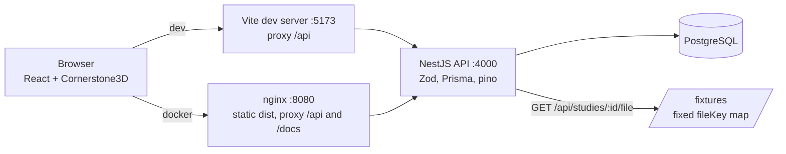
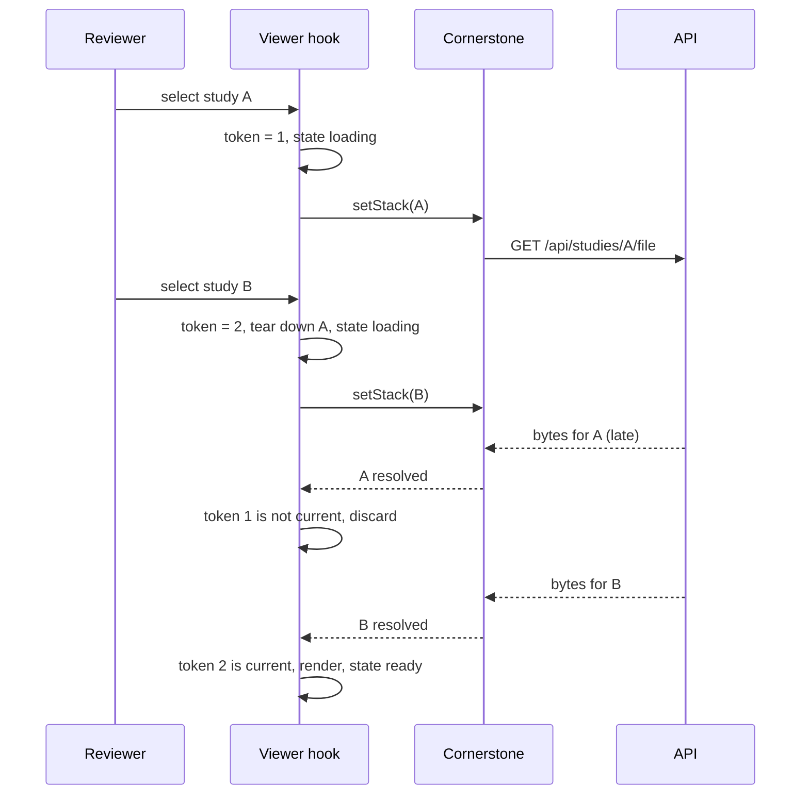
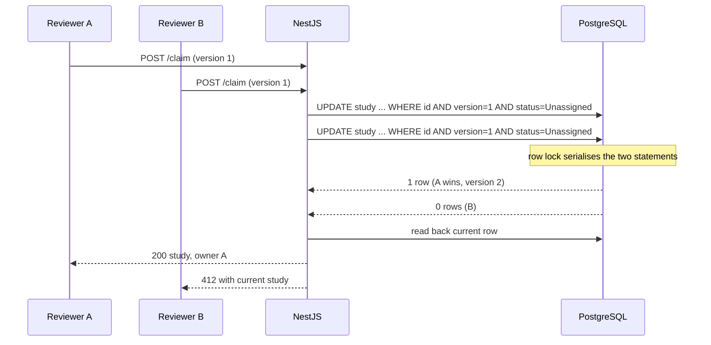

# Architecture

## Components

In development the browser talks to the Vite dev server, which proxies `/api` to NestJS.
In the Docker `app` profile, nginx serves the built SPA and proxies `/api` and `/docs`.

## Viewer load and the stale guard

Every load takes a sequence token. A result that arrives after the user switched or
closed the study carries an old token and is discarded instead of being drawn.

## Two reviewers claiming one study

## Request lifecycle

Each request gets an `X-Request-Id` (a valid incoming one is reused, otherwise generated),
which is echoed in the response and attached to every pino log line for that request;
pino redacts sensitive fields. Validation uses Zod. Failures leave the API in one error
envelope, `{ code, message, current? }`, where `current` is the up-to-date study on 412/409/403
conflicts so the client can refresh without another call.

## Known trade-offs

- Image size: the API runtime image copies the whole workspace `node_modules` and is not
  pruned. The seed runs through `tsx` and migrations through the Prisma CLI at container
  start, and both are dev dependencies, so a clean prune would mean reshuffling
  dependencies. Prod image is therefore large; acceptable for a demo.
- CPU rendering: deterministic pixels for tests, but slow for large or multi-frame
  images (ADR 0003).
- The modality filter options are hard-coded in the web app rather than loaded from the API.
- There is no upload endpoint; studies map to fixed fixture files, or to server-generated
  `local:<uuid>` keys from the dev-only local import, resolved inside `LOCAL_DICOM_DIR` (ADR 0004).
